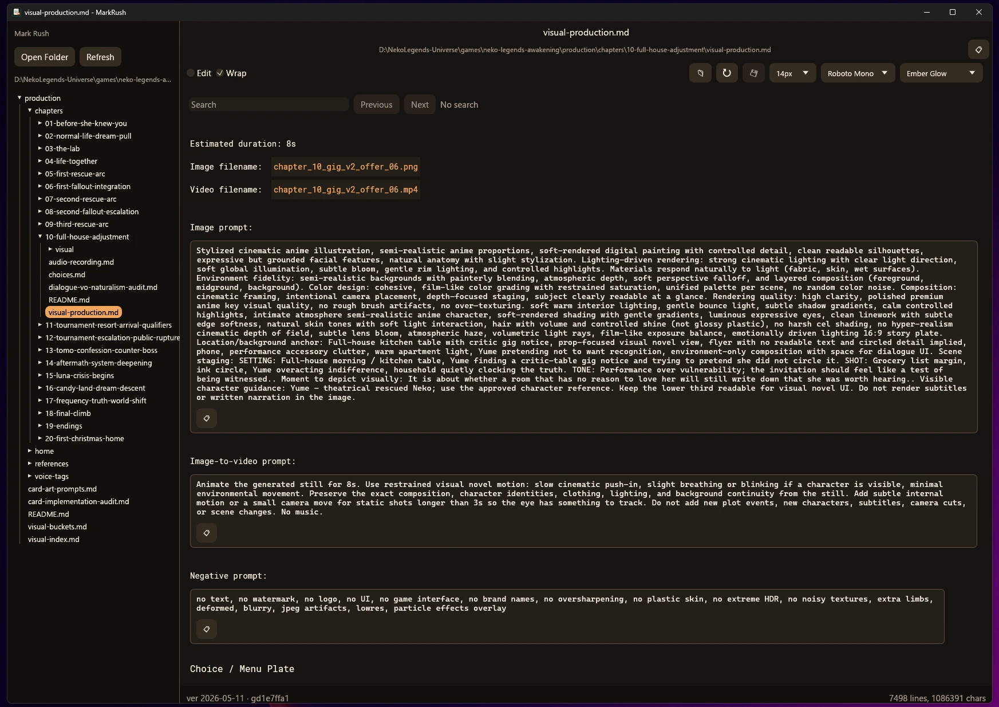

# MarkRush

MarkRush is a fast local Markdown viewer and editor for large files and large folders. It is built to open Markdown quickly and keep scrolling smooth even when a document has thousands of lines.

The app is written in Rust with egui/eframe and is intended to run on Windows, macOS, and Linux.

## Screenshot



## Features

- Open local folders with a native folder picker.
- Browse Markdown files in a cached, lazily loaded folder tree.
- Open folders or files from command-line arguments.
- Reopen the last folder and file on startup.
- Render large Markdown files as virtualized rows for responsive scrolling.
- Switch between rendered read mode and raw Markdown edit mode.
- Save with the Save button or `Ctrl+S`.
- Print with the Print button or `Ctrl+P`.
- Prompt before discarding unsaved edits.
- Search with `Ctrl+F`, `Enter`, `Shift+Enter`, `F3`, and `Shift+F3`.
- Follow local file links, folder links, heading anchors, and external URLs.
- Adjust document font family and font size from the top toolbar.
- Show the active filename and full path in a dedicated header area.
- Keep the bottom status bar focused on line and character counts.
- Persist theme, wrap mode, document font, window size, and rendered scroll position.
- Start first launch at one-quarter of the current screen area, then remember user resizing.
- Includes Venice-style themes plus High Contrast.
- Bundles redistributable document fonts: Noto Sans, Noto Serif, Lora, Poppins, and Roboto Mono.
- Writes crash logs to the platform app config directory.

## Download

Windows releases include a portable executable and an optional user-level installer.

- Portable EXE: download and run the executable directly; no install step is required.
- Installer: installs to `%LOCALAPPDATA%\Programs\MarkRush`, creates a Start Menu shortcut, and registers an uninstall entry for the current user.

## Build From Source

Install Rust from [rustup.rs](https://rustup.rs/), then clone and build:

```powershell
git clone https://github.com/flashosophy/MarkRush.git
cd MarkRush
cargo build --release
```

The release executable is produced under:

```text
target/release/
```

For local development:

```powershell
cargo run
```

On Windows, the direct release executable is:

```powershell
.\target\release\markrush.exe
```

## Windows Portable Executable

To create a Windows portable executable with a SHA256 checksum:

```powershell
.\Build-Windows.ps1
```

The package is written to:

```text
dist/
```

The Windows release binary embeds the app icon, generated version metadata, and uses the Windows GUI subsystem so double-clicking it does not open a blank console.

If Windows resource embedding fails, install the Visual Studio Build Tools or Windows SDK so Cargo can find the Windows resource compiler.

## Windows Installer

To create a Windows setup executable with a SHA256 checksum:

```powershell
.\Build-Windows-Installer.ps1
```

The installer build uses NSIS. If `makensis.exe` is not installed, the build script downloads a portable NSIS copy under `target/nsis`. The generated installer installs for the current user and does not require admin rights.

## Versioning

Release builds are stamped at compile time with a short date version plus git hash.

The full build version is shaped like:

```text
v26.5.19+gabcdef12
```

Meaning:

- `v26` = UTC build year, shortened to two digits
- `5` = UTC build month
- `19` = UTC build day
- `gabcdef12` = git commit hash
- `.dirty` is appended when the build was made with uncommitted tracked changes

For release binaries, commit first, then build so the executable contains the release commit hash.

## Development

Before committing code changes, run:

```powershell
cargo fmt
cargo check
```

Before handing off a release executable, run:

```powershell
cargo build --release
```

For Windows release packages, prefer:

```powershell
.\Build-Windows.ps1
```

The active app source is the Rust code in `src/`. The `reference/wpf` folder is kept only as an archived behavior reference from the original Windows implementation.

## License

MarkRush is released under the MIT License.

Bundled fonts in `assets/fonts` are distributed under the SIL Open Font License 1.1, with license text included next to each font file.
